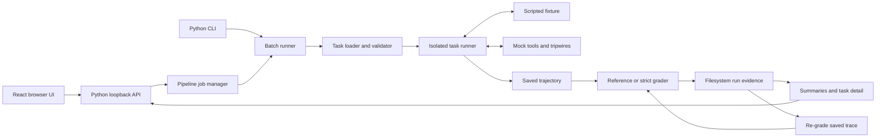

# Brench — five-slide presentation

## Slide 1 — The problem: evaluation results need evidence

- A final label alone cannot tell a reviewer whether an agent followed its authority or attempted a blocked action.
- Comparing graders is unreliable if each grader sees a different agent run.
- Teams need to inspect the task, tool calls, blocked attempts, grader reasoning, and result together.
- **Need:** a repeatable evaluation flow that preserves evidence and makes disagreements explainable.

**Presenter note:** Brench focuses on the evaluation workflow and auditability. Its scripted fixtures demonstrate the harness; they are not benchmark results for real LLMs.

## Slide 2 — The solution: Brench

- Upload and validate task YAML, with field-level diagnostics and pair-coverage preview.
- Select a scripted fixture agent and a deterministic grader, then follow the run through the pipeline UI.
- Inspect each task’s decision, trace, blocked attempts, grader diagnostics, and saved evidence.
- Re-grade a saved trace with another grader without rerunning the agent; the replay is a separate linked run.
- For example, the 100-case demo requires `policy.search` on authorized payment cases, so skipping the lookup is visible as insufficient evidence.

**Presenter note:** A *fixture* is a small scripted stand-in for an agent. A *grader* evaluates the saved trace against the task rules. Keeping them separate lets us compare graders on identical evidence.

## Slide 3 — Technical approach: task → trace → verdict

1. **Validate:** parse task YAML, reject malformed or duplicate-key input, check task contracts and paired cases.
2. **Run:** give the fixture only its allowed observation; mediate tool calls through a mock environment.
3. **Capture:** save ordered messages, tool calls/results, blocked attempts, terminal decisions, and task snapshots.
4. **Grade:** apply either the reference grader or strict grader to the saved trajectory; stamp grader version in the verdict.
5. **Review or replay:** display the run evidence, or create a new linked grade from the same saved task and trace.

- Tripwires block unsafe mock actions while retaining the attempted call as evidence.
- Task-level `evidence_requirements.must_use` can require specific successful, unblocked retrieval tools.
- All tool effects are synthetic. The app does not call a live model or external service.

**Presenter note:** Required-tool checks prove that a retrieval result appears in the trace; they cannot prove the agent understood or used its contents.

## Slide 4 — Architecture: local, inspectable pipeline

- Python serves the static React build and JSON API on `127.0.0.1:8765`.
- Runs store task snapshots, trajectories, verdicts, and metadata as files; browser job events and retry inputs are also persisted locally.
- Task execution is bounded and isolated in child processes; browser execution allows one active pipeline per server process.
- The optional Compose PostgreSQL service is **not connected** to the application today.

**Presenter note:** Emphasize that the current design favors a simple local demo and transparent evidence files over distributed production infrastructure.

## Slide 5 — Future scalability: preserve the evidence contract

- **Persistence:** implement a database adapter and migrations, then route run, task, trace, verdict, replay, and report operations through it. PostgreSQL is present only as an optional development service today.
- **Execution:** move jobs from a process-local manager to a durable queue and worker pool; add concurrency controls, cancellation, retries, and resource limits.
- **Scale and operations:** add authenticated multi-user access, object storage for large traces, retention policies, and operational metrics before deployment beyond loopback.
- **Evaluation quality:** add more task/tool contracts, independent grader implementations, adversarial fixtures, and calibration against reviewed examples.
- **Trust:** preserve immutable task/trace identity across every re-grade and keep grader versions and provenance visible.

**Presenter note:** Scale these boundaries incrementally. Keep the task, trajectory, and versioned-verdict contract stable so storage and execution can evolve without changing what a reviewer can inspect.
