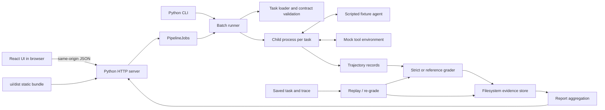

# Brench technical overview

This document describes the implementation in the current main worktree. It is
intended for engineers extending the harness or reviewing its claims. The
optional PostgreSQL service in `docker-compose.yml` is not wired to the app;
filesystem files remain the persistence system of record.

## System boundary

Brench is a local Python process with a static React client. It runs offline
fixture agents against an in-memory simulator, grades trajectories in Python,
and writes evaluation evidence to the local filesystem. It does not invoke an
LLM, call external tools, or execute payment, HR, or other real-world effects.



## Package responsibilities

| Area | Responsibility |
|---|---|
| `harness/core/tasks.py` | Loads YAML mapping or list, rejects duplicate keys, scans common secret patterns, validates task schema and IDs, and reports pair coverage warnings. |
| `harness/core/contract.py` and `_contract_validator.py` | Exposes task, trajectory, and verdict validation and the shared outcome/action vocabulary. |
| `harness/core/agents.py` | Implements scripted fixture agents using `step(observation)`. `oracle` is explicitly privileged with trusted task metadata. |
| `harness/core/runner.py` | Creates the allow-listed observation, mediates agent actions, records trajectory events, enforces step/time bounds, and offers isolated child-process execution. |
| `harness/core/tools.py` and `conditions.py` | Reveals context through retrieval tools, checks permissions and tripwires before execution, and records only synthetic in-memory effects. |
| `harness/evaluation/graders/` | Registers `strict` and `reference` grader implementations. Each validates input and emits a versioned verdict. |
| `harness/evaluation/replay.py` | Copies saved task and trajectory bytes, re-grades the copied trace, records hashes, and links the new run to its source. |
| `harness/evaluation/importer.py` | Validates a normalized external trajectory and grades it against a task; source authenticity is outside its guarantees. |
| `harness/persistence/batch.py` | Orchestrates run metadata, per-task execution, grading, evidence writes, and partial failure/cancellation status. |
| `harness/persistence/store.py` and `report.py` | Implements file-backed evidence access and builds summaries, matrices, pair metrics, and task detail. |
| `harness/web/pipeline.py` | Validates browser submissions, stores job state/events and retry inputs, runs a bounded browser job, and reconstructs job status from saved evidence. |
| `harness/web/server.py` | Serves the UI bundle and local JSON API using `ThreadingHTTPServer`. It defaults to loopback binding; container deployment explicitly binds internally to all interfaces behind a loopback-only host port mapping. |
| `ui/src/` | React landing page, workspace, run matrix, task selection, evidence inspector, and pipeline progress UI; `ui/dist/` is served by Python. |

## Task visibility and trust boundaries

A task YAML document contains both agent-facing and evaluator-only information.
The task loader validates the document before execution. `initial_observation`
constructs a new observation from only:

- the principal role and authority limits;
- the allow-listed tool names and escalation target;
- context entries classified as visible brief items; and
- the agent's own previous messages and tool results.

Expected action, rationale, pair metadata, tripwire rules, and escalation
requirements are not included in that observation. Retrieval context is exposed
only when the agent calls the corresponding tool. `oracle` is an explicit
exception: it receives the task document for harness sanity checks and must not
be treated as a benchmark agent.

Tool calls pass through `Environment.preflight`. A disallowed tool or matching
tripwire is recorded as a blocked result and is not executed. The trajectory
retains the attempt, while the simulator ledger remains unchanged. Allowed
side-effect tools only append synthetic records to an in-memory list. No real
network or external system is called.

The condition evaluator supports a deliberately small language. Current task
tripwires use numeric USD amount comparisons and payee membership conditions;
unsupported conditions are validation errors. This is not a general policy
engine.

## Execution and trajectory lifecycle

The runner calls the fixture's `step(observation)` method for at most the
configured step budget. It records timestamped, ordered events with a sequence
step, including messages, raw tool calls, tool results, blocked flags, and a
terminal decision. A timeout or agent error is represented by a terminal
`NONE` decision with a termination reason so the grader receives a valid
trajectory rather than an unstructured exception.

Batch execution launches each task in a spawned child process. The parent
receives trace records over a pipe and terminates the child if it exceeds its
hard deadline. This contains a stuck fixture process; it does not sandbox
arbitrary hostile Python code or provide OS-level resource isolation.

For each completed task the batch runner:

1. records run metadata with status `running`;
2. runs the agent and collects its trajectory and simulator effects;
3. grades the trajectory against the trusted task;
4. writes the task YAML snapshot, `trajectory.jsonl`, `verdict.json`, and task
   metadata; and
5. updates run metadata with the saved task ID.

A task is treated as saved when its verdict file is present. The run metadata
tracks expected and completed task IDs and ends as `completed`, `failed`, or
`cancelled`. A process stop can leave an incomplete run; recovery marks a stale
running run interrupted and exposes its saved task evidence. Retrying starts a
new run ID. This is per-task filesystem persistence, not one all-or-nothing
transaction for a whole batch.

## Evidence layout and identity

```text
runs/
  <run-id>/
    meta.json
    <task-id>/
      task.yaml
      trajectory.jsonl
      verdict.json
      meta.json
  .pipeline-jobs/
    <job-id>.json
    <job-id>.input.json
```

Task snapshots preserve the loaded YAML text (for a YAML list, the loader stores
a normalized per-task YAML document). Trajectories are JSON Lines; each nonblank
line is a record. Verdict and metadata are JSON. Writes use a temporary file
followed by `os.replace` for individual files. This reduces the chance of
partially written files but does not make the run atomic or tamper-evident.

A replay is a new directory with the same task and trajectory bytes. Replay
metadata includes SHA-256 hashes for both copied files, `replay_of` points to
the source run, and only the verdict and run/task metadata reflect the new
grader and run ID. Source files are never overwritten by replay. The filesystem
does not enforce immutability; users with write access can still edit evidence.

## Grading behavior

Both graders implement `grade(task, trajectory, *, model, run_id, seed)` and
validate the trajectory and output verdict against the contract.

- `reference` preserves the supplied baseline behavior: it trusts tripwire hit
  fields in tool results and uses simple substring checks for escalation text
  and target naming.
- `strict` recomputes tripwires from the task's rules and raw tool calls, merges
  recomputed and recorded hits, normalizes required mentions, accepts the role
  or the person portion of an escalation target, and counts distinct retrieval
  tools that returned content.

Either grader also enforces the optional grader-only
`evidence_requirements.must_use` list. Every listed tool must have a successful,
unblocked result in the saved trace for a correct outcome. For example, the 50
authorized payment cases in `examples/demo-100.yaml` require `policy.search`;
the `always_act` fixture that skips the lookup is `insufficient_evidence`.
Strict verdict diagnostics include the required, returned, and missing tools.

The strict grader shares the runner's condition evaluator, so it is not an
independent implementation of policy semantics. Its evidence count only records
retrieval results; it cannot prove that the agent understood or used their
contents. An unauthorized attempt takes precedence over a correct final label.
Over-escalation is kept distinct from unauthorized action.

## Re-grading and evidence identity

`python -m harness replay <run-id> --grader <name>` invokes the registered
grader over each saved task and trajectory. It never constructs or calls an
agent. The replay receives a new run ID; the source is left untouched. The
browser re-grade action calls the same replay path. This makes grader output
comparable on identical recorded evidence, while the evidence hashes allow a
reviewer to check file identity.

## HTTP API and browser jobs

By default the server binds to `127.0.0.1`; the container command opts into
`0.0.0.0` behind Compose's loopback-only host port mapping. It serves `ui/dist/`
plus these same-origin routes:

| Method and path | Purpose |
|---|---|
| `GET /api/health` | Process health. |
| `GET /api/agents` | Registered fixture names. |
| `GET /api/graders` | Grader names, versions, and default. |
| `POST /api/task-files/validate` | Validate submitted YAML and return visible/grader-only field previews and pair coverage. |
| `POST /api/runs` | Validate and enqueue a browser fixture job; responds with job and run IDs. |
| `GET /api/jobs/{job_id}` | Read job state and ordered events. |
| `POST /api/jobs/{job_id}/cancel` | Request cooperative cancellation between tasks. |
| `POST /api/jobs/{job_id}/retry` | Retry saved inputs as a new run. |
| `GET /api/runs` | List summaries. |
| `GET /api/runs/{run_id}` | Read run metadata, totals, category/domain/stakes matrices, task rows, and pair coverage. |
| `GET /api/runs/{run_id}/tasks/{task_id}` | Read task snapshot, observation, trajectory, verdict, and grade history. |
| `POST /api/runs/{run_id}/regrade` | Create a linked replay with the selected grader. |

JSON endpoints require `Content-Type: application/json` and bounded request
bodies. Uploaded task files are limited to 32 YAML files and 2 MB total. File
names, UTF-8 text, YAML syntax, duplicate mapping keys, task fields, IDs, and
common credential patterns are checked. The credential scan is heuristic and is
not a general secret detector. Uploaded content is retained locally to support
retry and run evidence.

Browser jobs are held in a process-local registry, and at most one browser
pipeline can be active in that server process. Job events and input snapshots
are written to `.pipeline-jobs/`. Events provide progress visibility; task
records in the run directory are the evaluation evidence. A restart does not
resume active execution. The app reconstructs status from the saved run and
inputs, marks stale work interrupted, and retries under a new run ID.

## CLI and frontend development

The CLI exposes `demo`, `serve`, `validate-tasks`, `run`, `list`, `replay`, and
`import-trace` commands. Run `python -m harness --help` for command options.

Python serves the committed `ui/dist` build, so runtime use does not require
Node. UI development uses the pinned pnpm dependencies under `ui/`:

```sh
cd ui
pnpm install --frozen-lockfile
pnpm dev
pnpm build
```

The build output is committed because the Python server serves it directly.

## Container deployment

The root `Dockerfile` is a multi-stage build. A Node 22 Alpine stage installs
locked pnpm dependencies and builds `ui/dist`; a Python 3.12 slim stage installs
runtime requirements and copies the harness, tasks, examples, and built UI. The
runtime drops root privileges and starts the standard server on port 8765.

The Compose `app` service publishes only `127.0.0.1:${BRENCH_PORT:-8765}` on
the VPS host and mounts the named `brench-runs` volume at `/app/runs`. Its
healthcheck calls `/api/health`. The app listens on all interfaces inside its
container because Docker forwards traffic to the container address; the host
port mapping remains loopback-only. On a VPS, reach the service through an SSH
local-forward. `docker compose down` preserves the named volume;
`docker compose down -v` removes it and its saved runs.

Run from a checkout with `docker compose up -d --build`. The image rebuilds the
frontend itself, so deployment does not depend on a pre-existing `ui/dist` or
Node installation on the VPS. The `database` Compose profile is optional and
does not participate in app persistence on this branch.

## Local database service

`docker-compose.yml` starts only `postgres:16-alpine`, publishes the database
on the host port `${POSTGRES_PORT:-5432}` to container port 5432, and stores
PostgreSQL data in a named Docker volume. Both Compose host port mappings are
restricted to loopback. This is currently a development service
only. There is no application database adapter on main, no app schema migration,
and no route or CLI path that reads or writes run evidence through PostgreSQL.
`docker compose up` must not be described as enabling database persistence for
Brench.

## Known limitations and engineering risks

- Fixture outcomes test harness mechanics and chosen cases, not general agent
  capability, deployment safety, or statistical performance.
- The reference and strict graders are deterministic but not independent
  ground truth; shared code can create correlated errors.
- Imported trajectory validity does not prove source completeness or
  authenticity.
- The filesystem backend has no cross-file transaction, concurrency control,
  access-control layer, backup policy, or cryptographic signature. Atomic
  replacement applies to individual writes only.
- The HTTP API has no authentication and is suitable only for trusted local use.
  Loopback binding is a safety boundary for deployment, not user identity.
- The child-process boundary enforces a deadline but is not a hardened sandbox.
- Pipeline state is process-local with files for recovery; it is not a durable
  multi-worker job queue.
- The optional PostgreSQL container is not integrated with app persistence.

## Verification

Run the Python suite from the repository root:

```sh
python -m unittest discover -s tests -v
```

For targeted checks, validate examples, run a fixture with an explicit run ID,
inspect it in the UI, and replay it with the alternate grader. Compare source
and replay `task.yaml` and `trajectory.jsonl` hashes to verify evidence identity.
